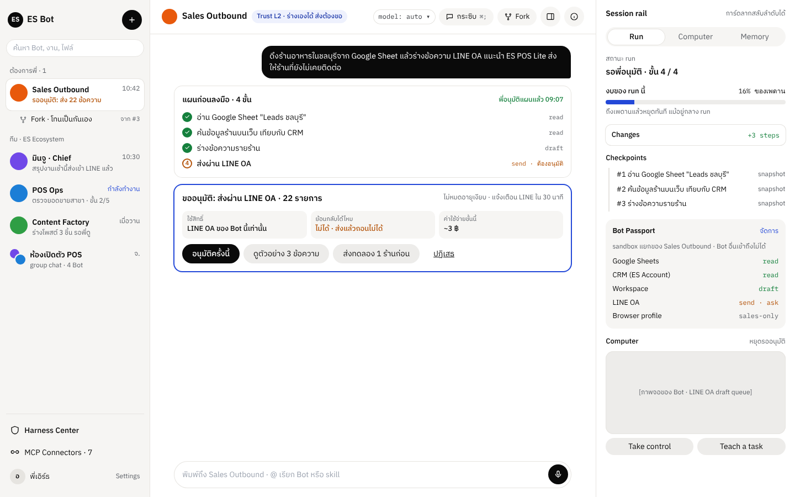
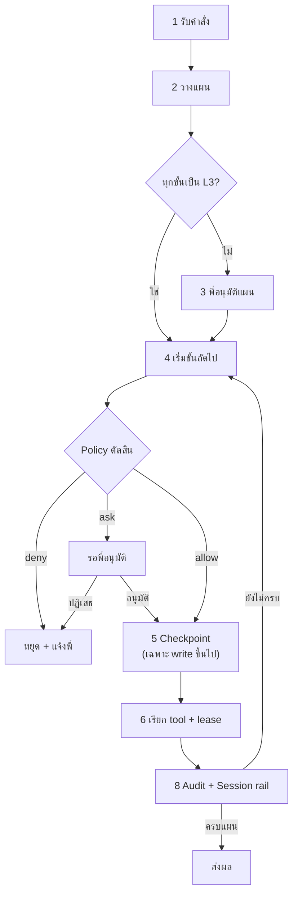
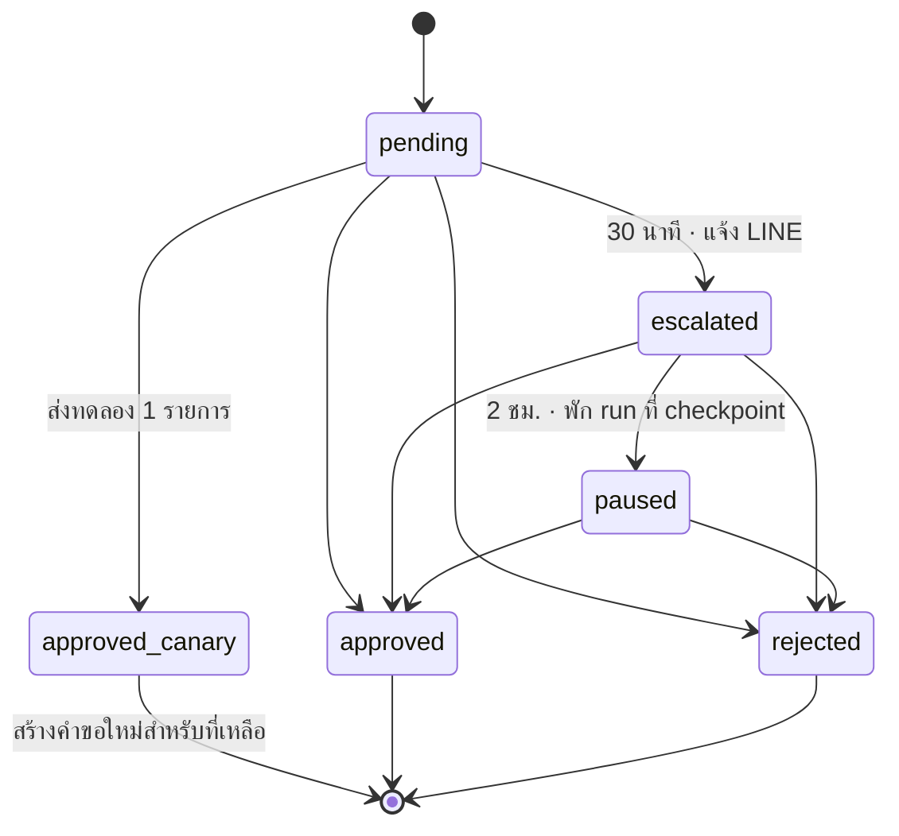
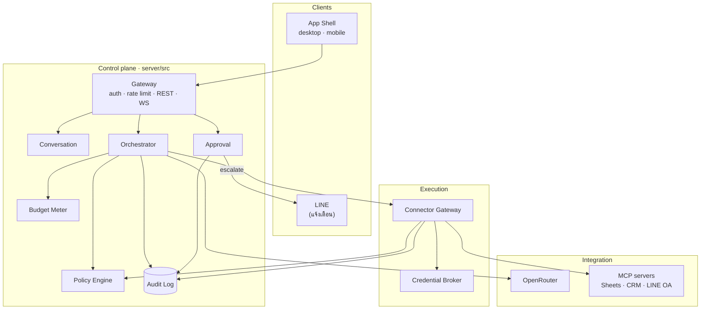
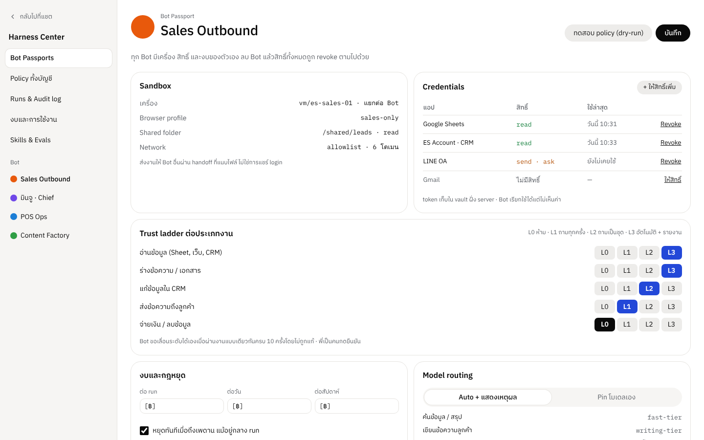
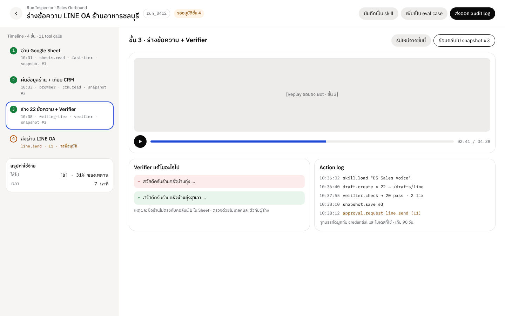
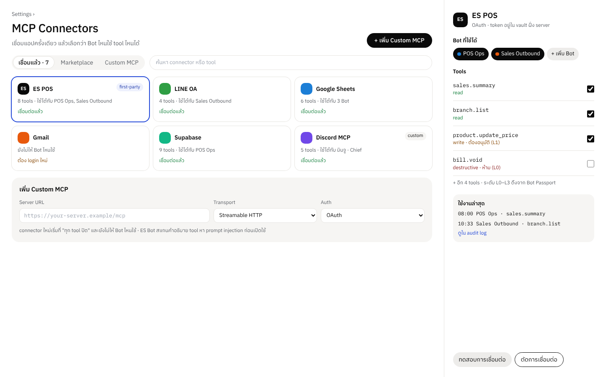
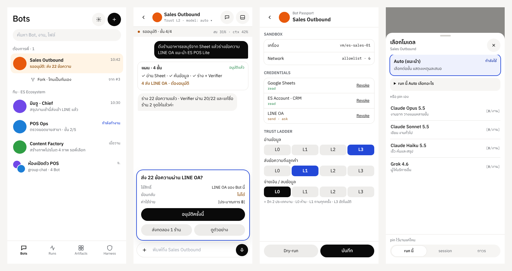

<div align="center">

# ES Bot

**AI teammate ของ ES Ecosystem ที่ harness โปร่งใสและคุมได้**

Bot ทำงานแทนพี่ได้ แต่ทุก action ต้องผ่าน Policy ก่อนเสมอ<br>
ไม่เห็น secret · ขอก่อนส่งของออกนอกบ้าน · ตรวจย้อนหลังได้ทุกขั้น


<br>



</div>

---

## สารบัญ

- [ES Bot ต่างจาก Bot ทั่วไปยังไง](#es-bot-ต่างจาก-bot-ทั่วไปยังไง)
- [เริ่มใน 5 นาที](#เริ่มใน-5-นาที)
- [Run หนึ่งรอบเป็นยังไง](#run-หนึ่งรอบเป็นยังไง)
- [สถาปัตยกรรม](#สถาปัตยกรรม)
- [Policy Engine และ Trust Ladder](#policy-engine-และ-trust-ladder)
- [ตั้งค่า](#ตั้งค่า)
- [API](#api)
- [หน้าจอ](#หน้าจอ)
- [โครงสร้างโปรเจกต์](#โครงสร้างโปรเจกต์)
- [สถานะและ roadmap](#สถานะและ-roadmap)
- [เอกสารที่เกี่ยวข้อง](#เอกสารที่เกี่ยวข้อง)

---

## ES Bot ต่างจาก Bot ทั่วไปยังไง

Bot ไม่ได้ถือสิทธิ์อะไรเองเลย ทุก tool call วิ่งผ่าน harness กลางที่ยึดหลัก 5 ข้อนี้

| | หลักออกแบบ | ในโค้ด |
|---|---|---|
| 🔐 | **Bot ไม่เคยเห็น secret** | Credential Broker เข้ารหัส secret ด้วย AES-256-GCM แล้วให้ lease อายุ 5 นาทีที่ใช้ได้ครั้งเดียว |
| 🛡️ | **ทุก side-effect ผ่าน Policy** | Connector Gateway ตัดสินซ้ำทุก call แม้ Orchestrator จะตัดสินมาแล้ว |
| 🧱 | **แยกต่อ Bot** | Passport ต่อ Bot บอกว่าเข้าถึง connector ไหน ด้วย scope อะไร งบเท่าไร |
| ↩️ | **ย้อนได้ หรือบอกชัดว่าย้อนไม่ได้** | checkpoint ก่อนทุกขั้น write และทุก tool ติดป้าย `reversible` |
| 🧾 | **ตรวจสอบได้ทุกอย่าง** | Audit log แบบ append-only (มี trigger กันแก้/ลบทั้งใน SQLite และ Postgres) |

คำอนุมัติ**ไม่หมดอายุเงียบ** ถ้าพี่ไม่ตอบใน 30 นาทีจะแจ้งเข้า LINE พอครบ 2 ชั่วโมงจะพัก run ไว้ที่ checkpoint แล้วรอจนพี่ว่าง
และคำอนุมัติผูกกับ hash ของเนื้อหา ถ้า Bot แก้ข้อความหลังพี่กดอนุมัติ ระบบจะไม่ยอมส่ง

---

## เริ่มใน 5 นาที

ต้องมี **Node 22.5 ขึ้นไป** (ใช้ `node:sqlite` ที่มากับ Node) ไม่ต้องมี key อะไรเลย ทุกบริการภายนอกมี mock ให้

```bash
git clone https://github.com/EarthStrixDEV/es-bot.git
cd es-bot
npm install
```

เปิด 2 terminal:

```bash
npm run dev:server
```

```bash
npm run dev
```

เปิด <http://localhost:5173> แล้วพิมพ์ในช่องแชตว่า

> ดึงร้านอาหารในชลบุรีจาก Google Sheet แล้วร่างข้อความ LINE OA แนะนำ ES POS Lite ส่งให้ร้านที่ยังไม่เคยติดต่อ

จากนั้นกด **อนุมัติแผน** → ดู Bot ทำ 3 ขั้นแรกเอง → กด **ส่งทดลอง 1 ร้านก่อน** → **อนุมัติครั้งนี้** สำหรับอีก 21 ร้าน

> [!TIP]
> ถ้าไม่ได้รัน `dev:server` หน้าเว็บจะแสดงสถานะตัวอย่างตามดีไซน์ เปิดดูหน้าจอครบ 20 หน้าได้โดยไม่ต้องมี backend

### คำสั่งทั้งหมด

| คำสั่ง | ทำอะไร |
|---|---|
| `npm run dev` | หน้าเว็บที่ `:5173` (proxy `/api` ไปที่ gateway) |
| `npm run dev:server` | gateway ที่ `:8787` แบบ watch |
| `npm run start:server` | gateway แบบไม่ watch |
| `npm test` | test ของ harness ทั้งหมด 27 ข้อ |
| `npm run typecheck` | typecheck ทั้งหน้าเว็บและ server |
| `npm run build` | build หน้าเว็บ |
| `npm run build:preview` | build ไฟล์ HTML ไฟล์เดียวสำหรับ preview แบบ static |

---

## Run หนึ่งรอบเป็นยังไง

Run คือแผนหนึ่งแผนที่มีหลายขั้น ทุกขั้นต้องผ่าน Policy ก่อนลงมือ และมี checkpoint ก่อนทุก write
ทุกการเปลี่ยนสถานะถูกบันทึกลงฐานข้อมูลก่อนไปต่อ ถ้า process ตายกลางทาง เปิดใหม่ก็ทำต่อจากขั้นเดิม



> ขั้นที่ 7 (Verifier) อยู่ในเฟส 3 ตอนนี้ยังข้ามไป

ลำดับของคำขออนุมัติ:



---

## สถาปัตยกรรม

ทุก client เข้าทาง Gateway ทางเดียว Control plane ตัดสินว่าจะทำอะไร ส่วน Execution plane เป็นที่เดียวที่ลงมือจริง



| โมดูล | โฟลเดอร์ | หน้าที่ |
|---|---|---|
| Gateway | `server/src/gateway` | bearer auth, rate limit, REST และ WebSocket `/api/events` |
| Conversation | `server/src/conversation` | thread และข้อความ |
| Orchestrator | `server/src/orchestrator` | เดิน run ทีละขั้น บันทึกทุก transition และ resume ได้ |
| Policy Engine | `server/src/policy` | ตัดสิน `allow` · `allow_and_report` · `ask` · `deny` |
| Approval | `server/src/approval` | lifecycle ของคำขอ, canary, ผูก payload hash |
| Budget Meter | `server/src/budget` | `reserve()` / `commit()` และหยุดทันทีเมื่อถึงเพดาน |
| Credential Broker | `server/src/credentials` | vault เข้ารหัส + lease อายุสั้น |
| Connector Gateway | `server/src/connectors` | tool registry, สแกน prompt injection, กรอง output, MCP client |
| Audit Log | `server/src/audit` | บันทึกแบบ append-only |
| Models | `server/src/models` | OpenRouter (หรือ mock ถ้าไม่มี key) |
| Notifier | `server/src/notifier` | LINE Messaging API (หรือ log ถ้าไม่มี key) |

ฐานข้อมูลตอนนี้เป็น SQLite ไฟล์เดียว ส่วน schema สำหรับ Supabase พร้อม Row Level Security อยู่ที่
[`server/db/migrations/001_init.sql`](server/db/migrations/001_init.sql)

---

## Policy Engine และ Trust Ladder

ทุก tool ต้องประกาศ metadata 3 อย่าง Policy ใช้ค่าเหล่านี้ตัดสิน

| Field | ค่า | ตัวอย่าง |
|---|---|---|
| `effect` | `read` · `draft` · `write` · `send` · `pay` · `destroy` | `line-oa.send_messages` = `send` |
| `reversible` | `yes` · `no` · `partial` | ส่งข้อความ = `no` |
| `blast` | `single` · `batch(n)` · `all` | 22 ร้าน = `batch(22)` |

ลำดับการตัดสิน (กฎที่เข้มกว่าชนะเสมอ):

1. **Hard deny:** `pay` และ `destroy` ห้ามเด็ดขาด
2. **Budget:** ถ้า `reserve()` ไม่ผ่าน run หยุดทันที
3. **Passport:** Bot ต้องมี grant ที่ scope ครอบ effect นั้น
4. **Trust ladder:** `L0` deny · `L1` ถามทุกครั้ง · `L2` ถามครั้งเดียวต่อ run · `L3` ทำแล้วรายงาน
5. **ตัวคูณความเสี่ยง:** ย้อนไม่ได้ หรือ blast เกิน 20 → เข้มขึ้น 1 ขั้น (ต่ำสุดที่ L1 ไม่ถึงขั้น deny)
6. **Auto-review:** ทำให้เข้มขึ้นได้อย่างเดียว ไม่มีทางผ่อนกฎ

<details>
<summary><b>ตัวอย่าง Passport ของ Sales Outbound</b></summary>

```json
{
  "botId": "sales-outbound",
  "sandbox": { "image": "es-base:2026.10", "browserProfile": "sales-only", "network": ["*.line.me", "docs.google.com"] },
  "grants": [
    { "connectorId": "google-sheets", "scope": "read", "resources": ["sheet:leads-chonburi"] },
    { "connectorId": "es-account", "scope": "read" },
    { "connectorId": "workspace", "scope": "draft" },
    { "connectorId": "line-oa", "scope": "send", "level": "L1" }
  ],
  "budget": { "perRun": 50, "perDay": 300, "hardStop": true, "unit": "THB" },
  "trust": { "read": "L3", "draft": "L3", "crm_write": "L2", "send": "L1", "pay": "L0", "destroy": "L0" }
}
```

</details>

---

## ตั้งค่า

คัดลอก `.env.example` เป็น `.env` ค่าที่ไม่ได้ตั้งจะใช้ mock แทน

| ตัวแปร | ค่าเริ่มต้น | ใช้ทำอะไร |
|---|---|---|
| `PORT` | `8787` | port ของ gateway |
| `DATA_PATH` | `server/.data/esbot.db` | ไฟล์ SQLite |
| `AUTH_TOKEN` | `dev-token` | bearer token ชั่วคราวก่อนต่อ ES Account |
| `MASTER_KEY` | ค่าสำหรับ dev | key สำหรับเข้ารหัส secret ของ connector **ต้องเปลี่ยนก่อนใช้จริง** |
| `BUDGET_PER_RUN` / `BUDGET_PER_DAY` | `50` / `300` | เพดานงบ (บาท) |
| `BLAST_THRESHOLD` | `20` | จำนวนรายการที่ถือว่าเสี่ยง |
| `OPENROUTER_API_KEY` | — | ใส่แล้วใช้โมเดลจริงผ่าน OpenRouter |
| `OPENROUTER_MODEL` | `openrouter/auto` | model id จาก [openrouter.ai/models](https://openrouter.ai/models) |
| `OPENROUTER_FALLBACK_MODELS` | — | รายชื่อโมเดลสำรอง คั่นด้วย comma |
| `LINE_CHANNEL_TOKEN` + `LINE_USER_ID` | — | แจ้งเตือนคำขออนุมัติเข้า LINE |
| `GOOGLE_SHEETS_MCP_URL` / `ES_ACCOUNT_MCP_URL` / `LINE_OA_MCP_URL` (+ `_TOKEN`) | — | ใช้ MCP server จริงแทน mock |
| `VITE_API_TOKEN` | `dev-token` | token ที่หน้าเว็บใช้เรียก gateway |

> [!NOTE]
> ระบบเรียกโมเดลผ่าน **OpenRouter อย่างเดียว** ไม่มี local model รายละเอียดอยู่ใน [ADR-0002](docs/adr/0002-openrouter-only.md)

> [!IMPORTANT]
> tool จาก MCP server จริงจะ**ปิดไว้ก่อนเสมอ** จนกว่าจะมีคนยืนยันผ่าน `POST /api/tools/:id/enable`
> และถ้าคำอธิบายของ tool เปลี่ยนภายหลัง ระบบจะปิดให้อัตโนมัติจนกว่าจะยืนยันใหม่

---

## API

ทุก request ต้องมี `Authorization: Bearer <AUTH_TOKEN>` ยกเว้น `/api/health`

| Method | Path | ใช้ทำอะไร |
|---|---|---|
| `GET` | `/api/health` | สถานะ, โมเดลที่ใช้, ช่องทางแจ้งเตือน |
| `GET` | `/api/bots` | รายชื่อ Bot |
| `GET` | `/api/bots/:id/passport` | Passport ของ Bot |
| `GET` | `/api/bots/:id/thread` | thread หลัก พร้อมข้อความและ run ทั้งหมด |
| `POST` | `/api/bots/:id/messages` | ส่งคำสั่ง `{ "text": "…" }` |
| `GET` | `/api/runs/:id` | run, steps, approvals, checkpoints, งบ |
| `GET` | `/api/approvals?state=open` | คำขอที่ยังรอคำตอบ |
| `POST` | `/api/approvals/:id/decision` | `{ "decision": "approve" \| "approve_canary" \| "reject" }` |
| `GET` | `/api/connectors` | connector ทั้งหมด (ไม่ส่ง secret ref ออกมา) |
| `GET` | `/api/tools` | tool พร้อม metadata และสถานะ |
| `POST` | `/api/tools/:id/enable` | ยืนยันและเปิดใช้ tool |
| `GET` | `/api/audit?target=` | audit log ล่าสุด 500 รายการ |
| `WS` | `/api/events?token=` | event stream: `message.*` `run.*` `step.*` `approval.*` `budget.*` |

```bash
curl -s localhost:8787/api/bots/sales-outbound/messages \
  -H "Authorization: Bearer dev-token" -H "Content-Type: application/json" \
  -d '{"text":"ดึงร้านอาหารในชลบุรีจาก Google Sheet แล้วส่ง LINE OA"}'
```

---

## หน้าจอ

ทำครบ 20 หน้าจอตาม canvas "ES Bot — App Design" ใช้ token ชุดเดียวกันทั้งหมด (IBM Plex Sans Thai + IBM Plex Mono, accent `#2348D8`)

<table>
<tr>
<td width="50%"><br><sub><b>Bot Passport</b> · สิทธิ์, sandbox และ trust ladder ต่อ Bot</sub></td>
<td width="50%"><br><sub><b>Run Inspector</b> · replay, diff ของ Verifier, action log</sub></td>
</tr>
<tr>
<td colspan="2"><br><sub><b>MCP Connectors</b> · เปิด tool ทีละตัว ตาม effect ที่ประกาศ</sub></td>
</tr>
<tr>
<td colspan="2"><br><sub><b>Mobile</b> · รายชื่อ Bot, แชต + approval, Passport, เลือกโมเดล</sub></td>
</tr>
</table>

<details>
<summary><b>Route ทั้งหมด</b></summary>

| Desktop | | Mobile | |
|---|---|---|---|
| `/` | Workspace + Session rail | `/m` | รายชื่อ Bot |
| `/passport` | Bot Passport | `/m/chat` | แชต + Approval |
| `/runs/run_0412` | Run Inspector | `/m/side-chat` | Side chat |
| `/side-chat` | Side Chat | `/m/rail` | Session rail |
| `/fork` | Fork Session | `/m/fork` | Fork Session |
| `/artifacts` | Artifacts | `/m/passport` | Bot Passport |
| `/images` | Image Preview | `/m/artifact` | Artifact |
| `/settings` | Settings | `/m/image` | Image Preview |
| `/connectors` | MCP Connectors | `/m/model` | เลือกโมเดล |
| `/models` | Model Selector | `/m/settings` | Settings + Connectors |
| `/screens` | รวมทุกหน้าจอ | | |

</details>

> หน้าที่ต่อ backend แล้วตอนนี้คือ Workspace (`/`) หน้าอื่นแสดงข้อมูลตัวอย่างตามดีไซน์ ค่าที่ดีไซน์ยังไม่ระบุจะเป็น `[placeholder]`

---

## โครงสร้างโปรเจกต์

```text
es-bot/
├── src/                        หน้าเว็บ (Vite + React + Tailwind)
│   ├── components/ui/          Button, Pill, Card, Meter, Composer, Icon …
│   ├── components/layout/      DesktopPage, PageHeader, MobileScreen, MobileTabBar
│   ├── lib/                    routes, api client, useBotThread, cn
│   └── screens/
│       ├── desktop/            10 หน้า (workspace/ ต่อ API แล้ว)
│       └── mobile/             10 หน้า
├── server/                     gateway (Node + TypeScript)
│   ├── src/
│   │   ├── policy/             Policy Engine
│   │   ├── orchestrator/       Orchestrator
│   │   ├── approval/  budget/  audit/  credentials/
│   │   ├── connectors/         Connector Gateway, MCP client, mocks
│   │   ├── models/             OpenRouter + mock
│   │   ├── gateway/            HTTP + WebSocket
│   │   └── store/              Store port + SQLite
│   ├── db/migrations/          schema Supabase + RLS
│   └── test/                   node:test
├── docs/adr/                   บันทึกการตัดสินใจ
└── tailwind.config.ts          design tokens
```

---

## สถานะและ roadmap

| เฟส | ขอบเขต | สถานะ |
|---|---|---|
| **1 · MVP** | แชต, Orchestrator, Policy L0–L3, Approval ผ่าน LINE, Connector Gateway 3 ตัว, Audit log | ✅ โค้ดครบ · 🟡 ยังใช้ mock |
| 2 · Computer | Sandbox, Credential Broker ใน browser, Take control, Rollback | ⬜ |
| 3 · Session power | Side chat, Fork, Model Router, Verifier | ⬜ |
| 4 · Output | Artifacts, Image generation, Skills / Routines | ⬜ |
| 5 · Team | Group chat, Team Bot, admin policy, mobile app เต็มรูปแบบ | ⬜ |

ก่อนปิดเฟส 1:

- [x] Push repo ขึ้น GitHub
- [ ] ทดสอบกับบริการจริง: OpenRouter, LINE OA, MCP ของ Google Sheets
- [ ] ต่อ Supabase และ ES Account auth
- [ ] ต่อหน้า Connectors, Passport, Run Inspector และ MChat เข้ากับ API
- [ ] Deploy หน้าเว็บ (Vercel) และ gateway (Node ที่รันตลอด)

---

## เอกสารที่เกี่ยวข้อง

- [ADR-0001 · สร้างเฟส 1 เป็น Node service แบบ ports/adapters](docs/adr/0001-mvp-harness-architecture.md)
- [ADR-0002 · ใช้ OpenRouter เป็นช่องทางเรียกโมเดลเพียงทางเดียว](docs/adr/0002-openrouter-only.md)
- ES Bot — Workflow, Modules & System Design (Claude Docs · private)
- ES Bot — App Design (canvas · private)

### เพิ่มโค้ดใหม่

1. ใช้ component ใน `src/components/ui` และ token ใน `tailwind.config.ts` ไม่ใส่สีหรือขนาดแบบ hard-code
2. โมดูลฝั่ง server คุยกันผ่าน interface หรือ event เท่านั้น และเก็บข้อมูลผ่าน `Store`
3. การตัดสินใจที่เปลี่ยนสถาปัตยกรรมให้เขียน ADR ใหม่ไว้ใน `docs/adr/`
4. ก่อน push ให้รัน `npm run typecheck` และ `npm test` ให้ผ่าน

<div align="center">
<sub>ES Ecosystem · ทำด้วย 💜</sub>
</div>
